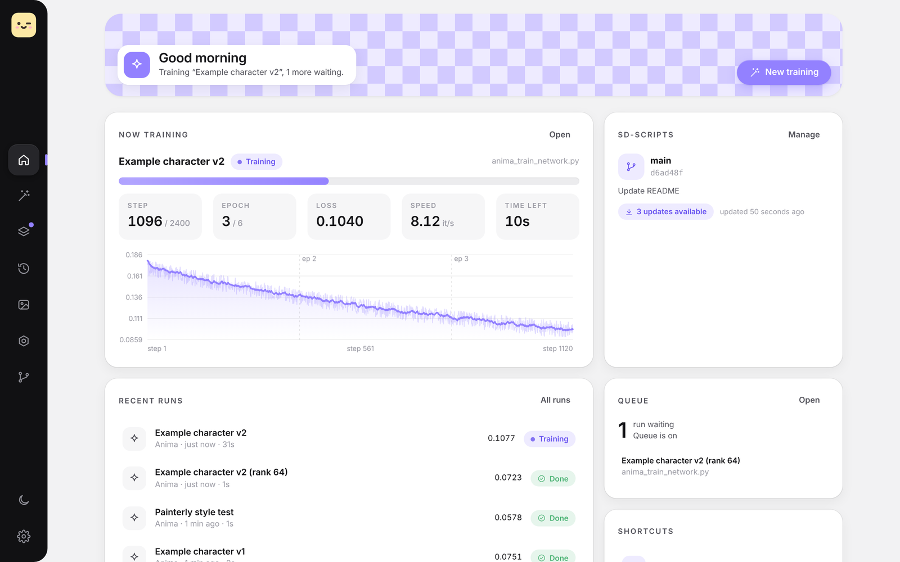
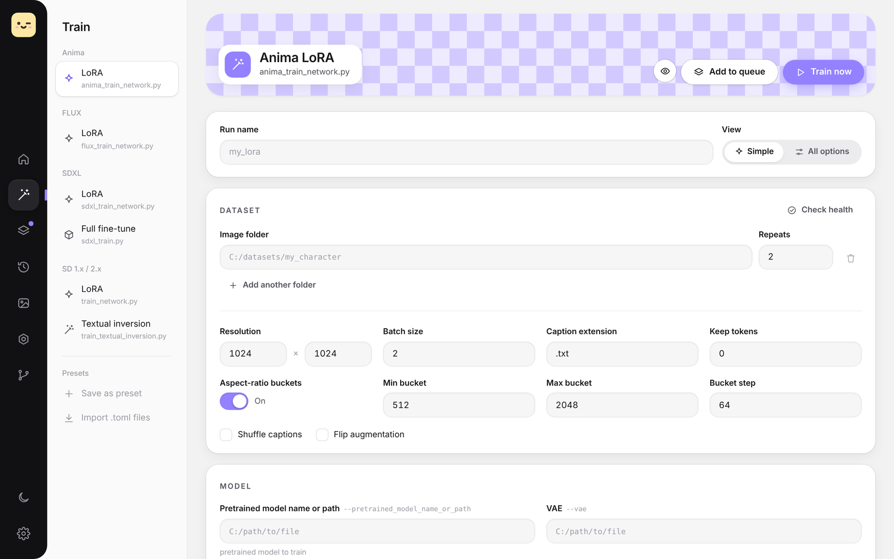
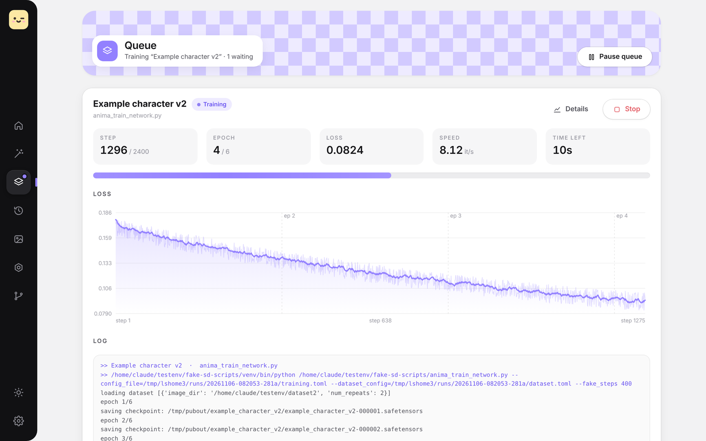
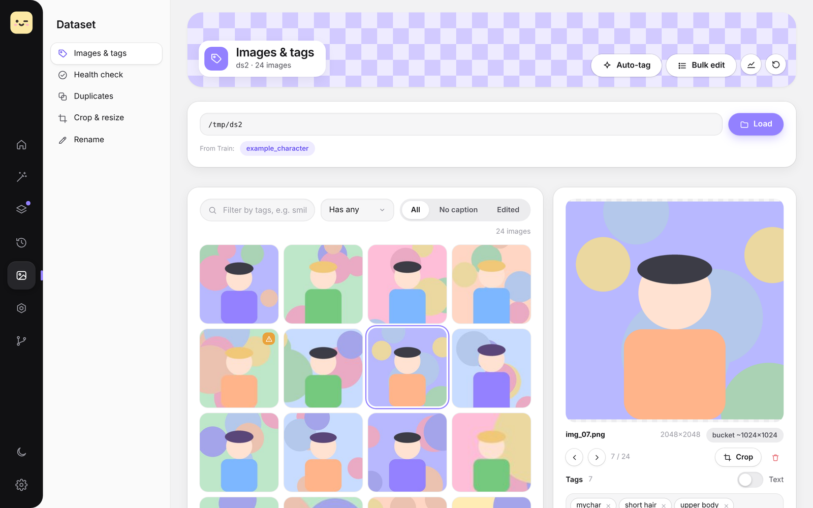
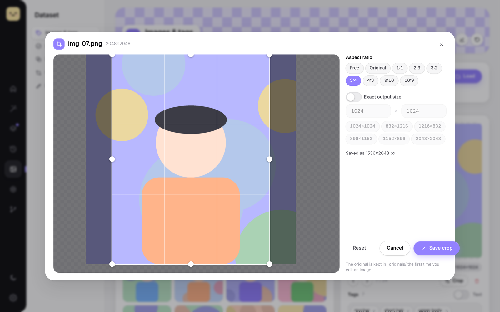
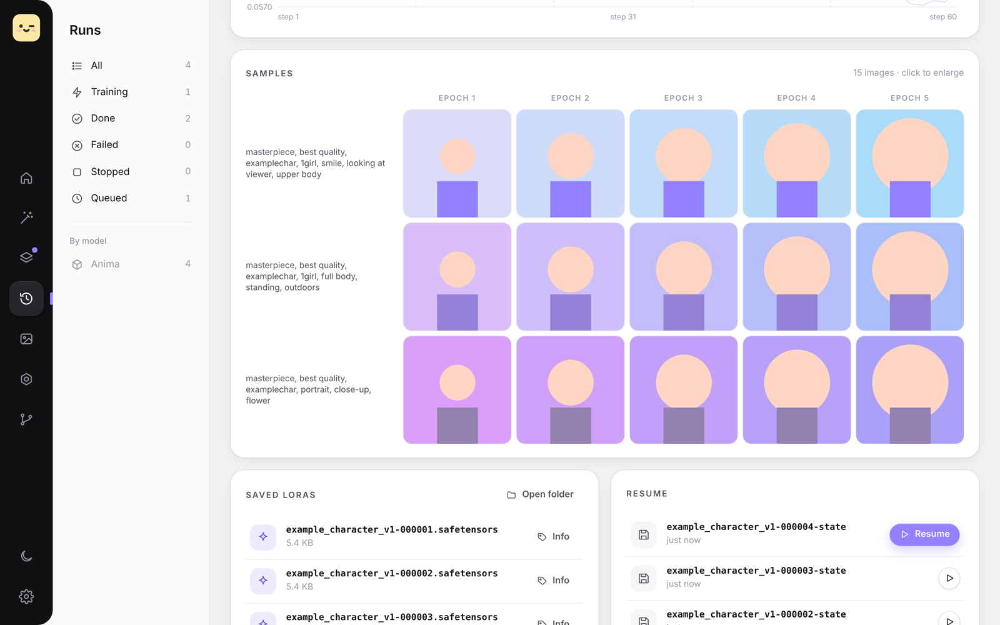
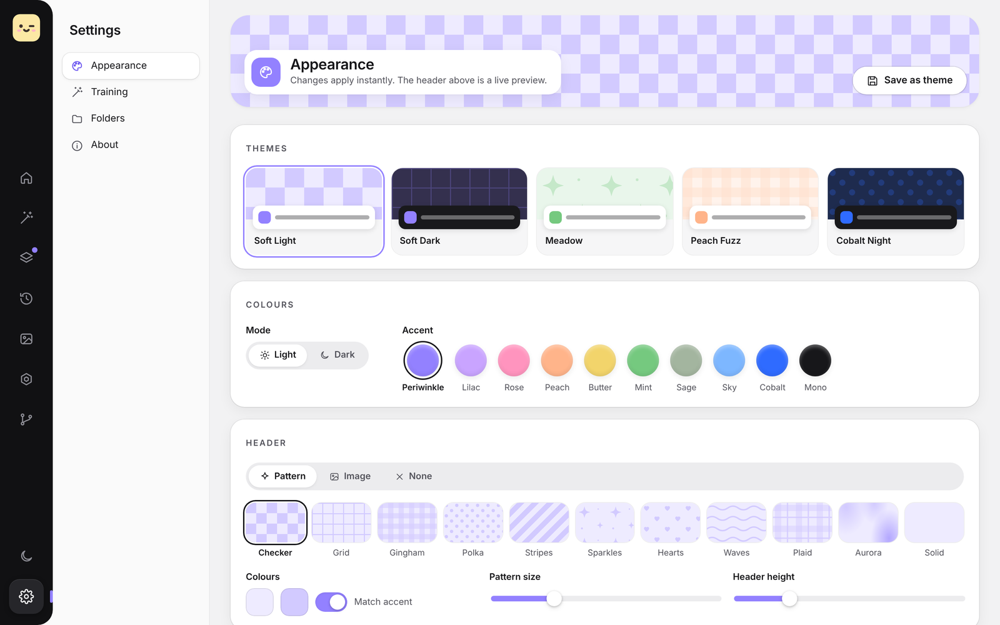

<p align="center">
  
</p>

<h1 align="center">LoRA Studio</h1>

<p align="center">
  A friendly Windows & Linux app for training LoRAs with <a href="https://github.com/kohya-ss/sd-scripts">kohya-ss/sd-scripts</a>:<br>
  set up a run, watch the loss, tidy your dataset, and send the result to SwarmUI or ComfyUI, all in one place.
</p>

<p align="center">
  
</p>

---

## What it does

**Training**
- **Any sd-scripts training script:** SD 1.x/2.x, SDXL, SD3, FLUX, Anima, Lumina and more. The form is built from the script's own options, so new options appear automatically when sd-scripts updates.
- **Simple and full views:** *Simple* shows the settings that matter; *All options* lists every one, with search.
- **Queue:** line up several runs and walk away. Watch live loss, speed, time left and the log.
- **Run history:** every run keeps its exact config, sd-scripts version, loss curve and log. Re-run it, tweak it, or **resume** from a saved state.
- **Sample previews:** your prompts are rendered every epoch and shown as a prompt × epoch grid. **Compare** any two with a slider or fade, or turn a prompt's samples into an **animated GIF**.
- **Presets:** save your favourite setups, or import existing `training.toml` / `dataset_config.toml` files. Pick a **default preset** that every **New session** starts from, and **share presets** as small files (your own paths are left out).
- **Time estimates:** see roughly how long a run will take before you start; LoRA Studio learns your GPU's speed from past runs.
- **Best epoch:** star the epoch you like in the sample grid; it's saved as `…-best.safetensors` and can be copied to SwarmUI or ComfyUI in one click.
- **GPU monitor:** VRAM, load, temperature and power while you train.
- **Notifications:** a desktop notification when a run finishes or fails.
- **Check before training:** wrong values, missing models or empty image folders are caught in seconds, before the model loads.
- **Overnight batches:** let the PC sleep or shut down when the queue is done (with a 1-minute countdown you can cancel).

**Dataset tools**
- **New dataset in one click:** download with **gallery-dl** (Danbooru, Gelbooru, e621, pixiv and hundreds more), skip tiny images, number everything, turn the site's tags into captions, and check for duplicates. Site logins and API keys are stored on your PC only.
- **Images & tags:** caption editor with tag chips, autocomplete, filters, keyboard shortcuts and bulk add/remove/replace with undo. The **tag overview** shows every tag by how often it's used (sort by rarest to spot typos), and renames or removes it everywhere.
- **Auto-tagging:** with the WD EVA02 tagger.
- **Crop & resize:** a Photos-style crop window, plus batch resize to a long side, short side or exact size (e.g. 1024×1024, 832×1216). Originals are always kept.
- **Duplicates:** finds look-alike images with CLIP; you review before anything moves, then delete them for good with one click.
- **Health check:** catches missing/empty captions, unreadable images, caption clashes, missing trigger words and odd sizes, and estimates buckets and steps.
- **Rename:** numbered names with a preview first.

**SwarmUI & ComfyUI**
- **Start them from the app:** use your existing SwarmUI and/or ComfyUI install, and open either one right inside LoRA Studio.
- **ComfyUI two ways:** the ComfyUI that runs inside SwarmUI (no extra setup), or a separate ComfyUI install (portable or git).
- **Copy LoRAs over:** finished LoRAs go straight into SwarmUI or ComfyUI. Title, trigger word and thumbnail are stored in the file, where SwarmUI's model browser shows them.
- **Test grids:** render epoch × strength grids through SwarmUI.

**Looks**
- **Modes and accents:** light and dark modes, plus 10 pastel accent colours.
- **Custom header:** a patterned header (checker, gingham, sparkles…) or your own art.
- **Your own styles:** a `custom.css` file for anything else.

<table>
  <tr>
    <td></td>
    <td></td>
  </tr>
  <tr>
    <td></td>
    <td></td>
  </tr>
  <tr>
    <td></td>
    <td></td>
  </tr>
</table>

---

## Requirements

- **Windows 10 or 11**, or **Linux** (see [Linux](#linux) below). On Windows the app window uses Microsoft Edge WebView2, which is built in.
- **Python 3.10 or newer**, from [python.org](https://www.python.org/downloads/). Tick **"Add python.exe to PATH"** when installing.
- **Git**, from [git-scm.com](https://git-scm.com/download/win).
- **sd-scripts.** If you don't have it yet, LoRA Studio can install it for you.

LoRA Studio itself is small. All the heavy machine-learning parts (PyTorch etc.) run inside **your sd-scripts install**, so nothing big is downloaded twice.

## Install

On Linux? Skip to [Linux](#linux).

1. **Download** this project: the green **Code** button → **Download ZIP**, or grab the latest from **Releases**. Unzip it somewhere permanent, e.g. `C:\AI\lora_studio`.
2. **Double-click `Install.bat`.** It creates a private Python environment in the folder and installs two small packages (`pywebview` and `Pillow`).
3. **Double-click `LoRA Studio.bat`** to start. Optionally run `Create desktop shortcut.bat` once for a desktop icon.
4. On first launch, **point it at your sd-scripts folder** (the one with `train_network.py`), or let it install a fresh copy.

### Updating

**The easy way:** when a new version is out, a small download button with a dot appears in LoRA Studio's sidebar (and in **Settings → About**). Click **Update now**: LoRA Studio downloads the new version, keeps your `.venv`, your `custom.css` and all your settings, runs and presets, installs anything new, and restarts with one click.

**By hand:** download the new zip and unzip it over your LoRA Studio folder (keep the `.venv` folder), or **Pull** in GitHub Desktop / `git pull` if you cloned it. Then start LoRA Studio as usual.

## Using it

| Page | What it's for |
|---|---|
| **Home** | What's training, what's queued, recent results, sd-scripts status |
| **Train** | Pick a script on the left, fill in the form, then **Train now** or **Add to queue** |
| **Queue** | Live progress, loss chart and log; reorder or remove waiting runs |
| **Runs** | Past runs: loss curve, samples, saved LoRAs and their info, resume, config and log |
| **Dataset** | New dataset (gallery-dl), images & tags, health check, duplicates, crop & resize, rename |
| **SwarmUI & ComfyUI** | Start/open either one, use it inside the app, and see the LoRAs you've sent it |
| **sd-scripts** | Update, switch branch, roll back |
| **Settings** | Appearance, launcher options, notifications, folders, backup & restore |

### Folders LoRA Studio creates in your dataset
- `_originals/` keeps the original of any image you crop or resize.
- `_deleted/` holds images deleted in the viewer, with their captions. You can restore them.
- `_duplicates/` holds images moved by the duplicate finder.

sd-scripts ignores all three folders.

### Downloading with gallery-dl
Dataset → **New dataset** → **Install gallery-dl** (one time). Pick a site and type tags, or paste any link gallery-dl supports.
- **Site logins:** sites that need a login or API key are set up under **Site logins**.
- **pixiv:** press **Get token** and follow the window that opens.
- **Other logged-in sites:** gallery-dl can use your browser's cookies; Firefox works best.

Downloads go to the `downloads` folder in LoRA Studio's data folder (`%APPDATA%\LoRA Studio` on Windows, `~/.local/share/lora-studio` on Linux) unless you pick a folder.

### Backup & restore
Settings → **Folders & backup** → **Create backup** saves your settings, presets, themes and run history in one zip. Your datasets, trained LoRAs and site logins aren't included.

### Resuming a run
Turn on **Save state** (Train → Output) before training. If a run is stopped or crashes, open it on the Runs page and press **Resume**.

### SwarmUI & ComfyUI
- **SwarmUI:** choose your SwarmUI folder on the SwarmUI tab. LoRAs are copied to `<SwarmUI LoRA folder>/LoRA Studio/<name>/`. Test grids need SwarmUI running; the **Start SwarmUI** button launches it.
- **ComfyUI:** on the ComfyUI tab, pick **The one inside SwarmUI** (nothing else to set up) or **A separate ComfyUI install**. For a separate install, choose its folder: the portable folder with `run_nvidia_gpu.bat`, or a git install with `main.py`. LoRAs are copied to `models/loras/LoRA Studio/<name>/`; refresh ComfyUI's LoRA list to see them.

### Making it yours
- **Settings → Appearance:** pick a mode, an accent and a header, then **Save as theme**.
- **`web/css/custom.css`:** loaded last, so anything you put there wins. You can add accents, change roundness or fonts, and more.

---

## For developers

The app is plain Python plus HTML/CSS/JS with no build step.

```
main.py                 starts the window (or --browser for a normal browser tab)
install.sh, lora-studio.sh, create-desktop-entry.sh   the Linux versions of the .bat files
tests/                  quick checks (python -m pytest tests) + a browser smoke test, run on every pull request
studio/                 Python backend
  api.py                every function the UI can call
  sdscripts.py          find / install / update / switch / roll back sd-scripts; read a script's options
  _schema_dump.py       runs inside the sd-scripts venv to read argparse options
  trainer.py            queue, launching, live log + loss parsing
  runs.py               run history, resume points, outputs
  dataset_tools.py      captions, bulk edits, rename, crop/resize, delete/restore, autocomplete
  health.py             dataset health check + bucket/step estimate
  samples.py            sample prompt files and sample-image discovery
  metadata.py           read/write .safetensors metadata (no torch needed)
  swarm.py              SwarmUI: detect, launch, copy LoRAs, test grids
  gallerydl.py          gallery-dl: install, site logins, downloads
  importer.py           downloaded folder → clean numbered, captioned dataset
  estimate.py           training-time estimates from past runs
  gpu.py / notify.py    nvidia-smi stats / desktop notifications
  backup.py             backup & restore of LoRA Studio's own data
  comfy.py              ComfyUI: inside SwarmUI or a separate install
  workers/              tagger + duplicate finder; these run inside the sd-scripts venv
web/                    the UI
  css/tokens.css        theme colours (light/dark + accents)
  css/app.css           components
  css/custom.css        user overrides
  js/pages/*.js         one file per page
  js/tools/*.js         dataset tools
```

Run `python main.py --browser` to develop in a normal browser with dev tools.

---

## Credits

- [kohya-ss/sd-scripts](https://github.com/kohya-ss/sd-scripts) does all the actual training.
- [SwarmUI](https://github.com/mcmonkeyprojects/SwarmUI) by mcmonkey, and [ComfyUI](https://github.com/comfyanonymous/ComfyUI).
- The WD EVA02 tagger and OpenAI CLIP models are used by the dataset tools and downloaded from Hugging Face on first use.
- [pywebview](https://pywebview.flowrl.com/) provides the app window.
- [gallery-dl](https://github.com/mikf/gallery-dl) handles downloads (installed on request).

LoRA Studio is an independent project and isn't affiliated with kohya-ss, SwarmUI, ComfyUI or Stability AI.

## License

[MIT](LICENSE)
