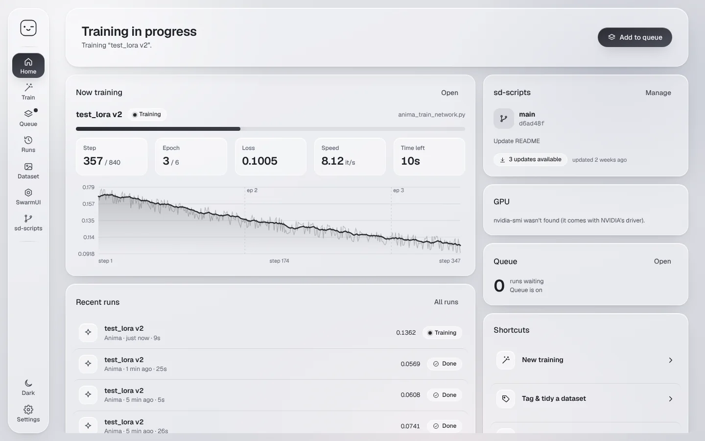
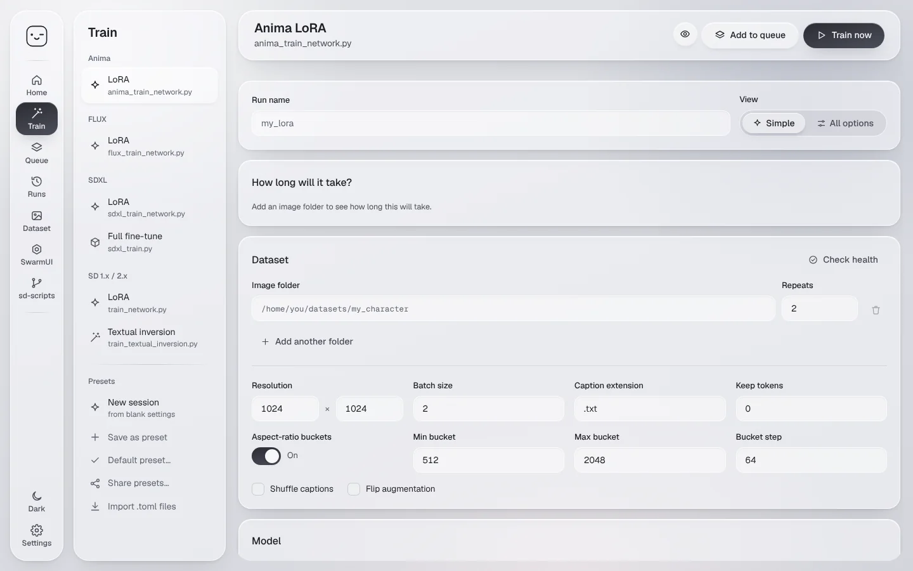
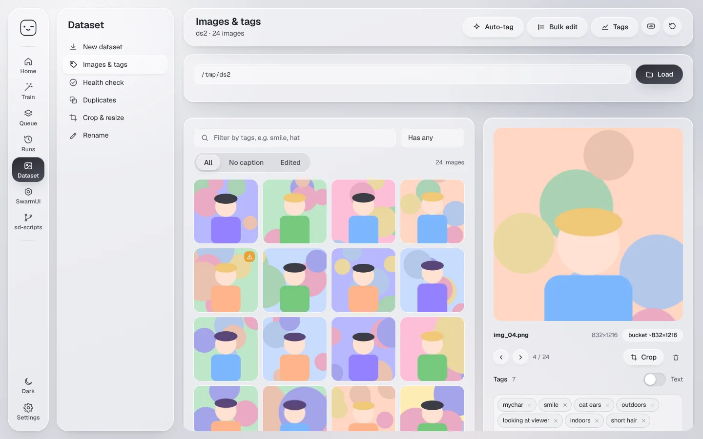

  

<h1 align="center">LoRA Studio</h1>

  A friendly Windows & Linux app for training LoRAs with <a href="https://github.com/kohya-ss/sd-scripts">kohya-ss/sd-scripts</a>.

  

## What it does

- **Train** with any sd-scripts script (SDXL, FLUX, Anima and more) through a form built from the script's own options.
- **Queue** runs and watch the loss, speed and time left live. Every run keeps its settings and log, and can be resumed.
- **Compare samples** epoch by epoch, and star the epoch you like best.
- **Tidy your dataset**: download with gallery-dl, edit tags, auto-tag, crop and resize, find duplicates, and run a health check.
- **Send LoRAs** to SwarmUI or ComfyUI in one click, and render test grids.

<table>
  <tr>
    <td></td>
    <td></td>
  </tr>
</table>

## Install (Windows)

You need [Python 3.10 or newer](https://www.python.org/downloads/) (tick **Add python.exe to PATH**) and [Git](https://git-scm.com/download/win).

1. Download the latest version from [Releases](https://github.com/cococolacake/lora-studio/releases/latest) and unzip it somewhere permanent, like `C:\AI\lora_studio`.
2. Double-click **`Install.bat`**.
3. Double-click **`LoRA Studio.bat`** to start. `Create desktop shortcut.bat` adds a desktop and Start menu shortcut.
4. Point it at your sd-scripts folder, or let it install sd-scripts for you.

On Linux, run `./install.sh` and then `./lora-studio.sh`. See the [Linux setup](docs/guide.md#linux) for details.

**Updating:** when a new version is out, a download button appears in the sidebar. Click it, then **Update now**.

## Learn more

The [guide](docs/guide.md) covers every feature, each page, gallery-dl and site logins, SwarmUI and ComfyUI setup, backups, and notes for developers.

## Credits

Training is done by [kohya-ss/sd-scripts](https://github.com/kohya-ss/sd-scripts). LoRA Studio also works with [SwarmUI](https://github.com/mcmonkeyprojects/SwarmUI), [ComfyUI](https://github.com/comfyanonymous/ComfyUI) and [gallery-dl](https://github.com/mikf/gallery-dl), and isn't affiliated with any of them. [Full credits](docs/guide.md#credits).

[MIT license](LICENSE)
