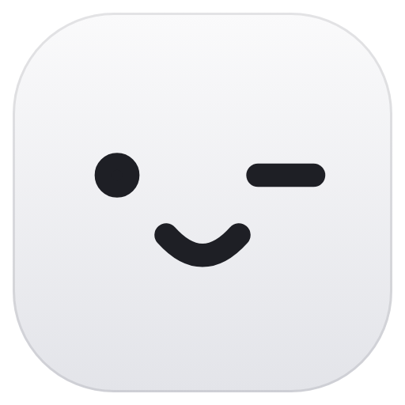
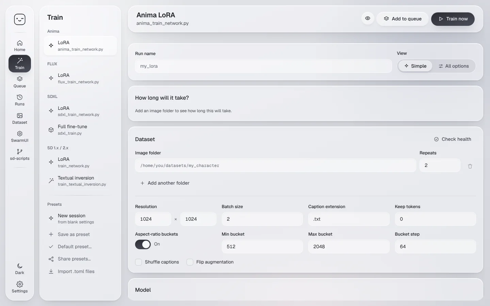
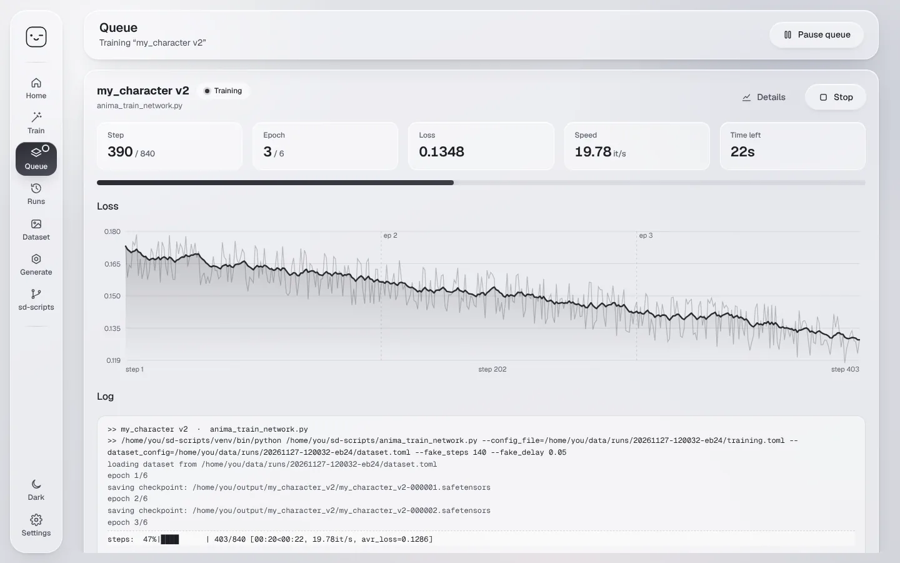
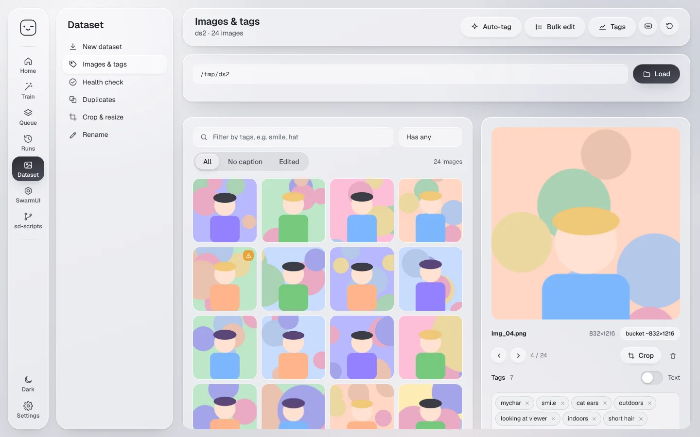
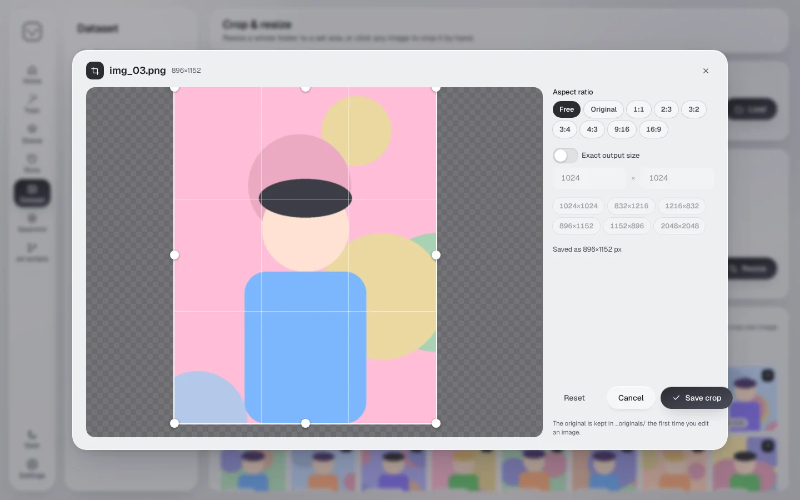
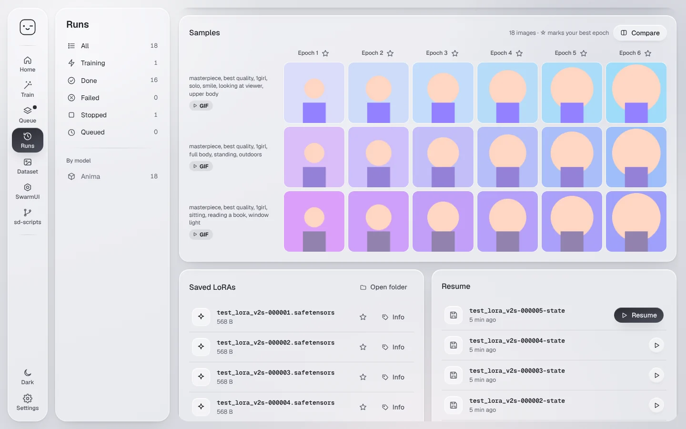
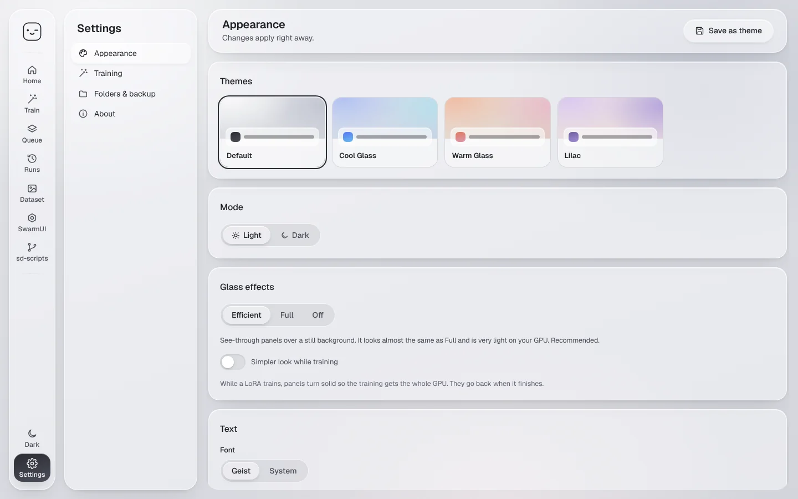
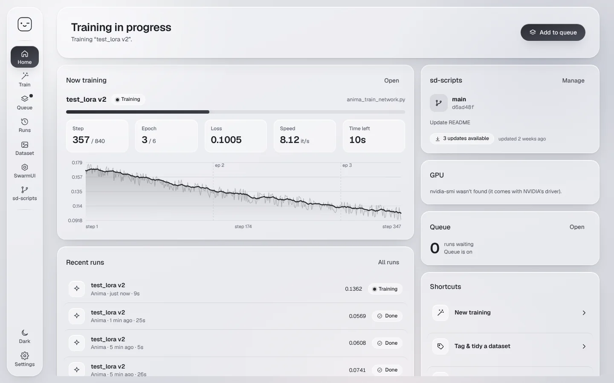
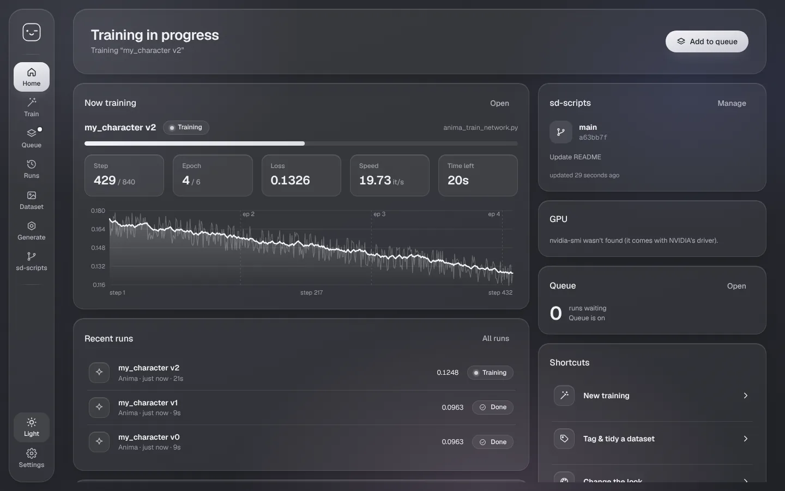

  

**LoRA Studio** is a friendly Windows & Linux app for training LoRAs with [kohya-ss/sd-scripts](https://github.com/kohya-ss/sd-scripts).

## Start here

- **[Getting started](Getting-started)**: what you need, installing on Windows or Linux, and a tour of the pages.
- **[Training](Training)**: the training form, the queue, runs, samples, presets and resuming.
- **[Datasets](Datasets)**: downloading with gallery-dl, editing tags, auto-tagging, cropping, duplicates and the health check.
- **[SwarmUI and ComfyUI](SwarmUI-and-ComfyUI)**: starting them from the app, copying LoRAs over and test grids.
- **[Themes](Themes)**: glass themes, CSS themes and `custom.css`.
- **[Updating and backups](Updating-and-backups)**: keeping LoRA Studio up to date, and backing up your settings and runs.
- **[FAQ](FAQ)**: quick answers.

How LoRA Studio was made, and where to ask me questions: see the [AI disclosure](AI-disclosure). LoRA Studio is free and open source, forever.

Developing LoRA Studio? See [CONTRIBUTING.md](https://github.com/cococolacake/lora-studio/blob/main/CONTRIBUTING.md).

## Screenshots

<table>
  <tr>
    <td></td>
    <td></td>
  </tr>
  <tr>
    <td></td>
    <td></td>
  </tr>
  <tr>
    <td></td>
    <td></td>
  </tr>
  <tr>
    <td></td>
    <td></td>
  </tr>
</table>

## Credits

- [kohya-ss/sd-scripts](https://github.com/kohya-ss/sd-scripts) does all the actual training.
- [SwarmUI](https://github.com/mcmonkeyprojects/SwarmUI) by mcmonkey, and [ComfyUI](https://github.com/comfyanonymous/ComfyUI).
- The WD EVA02 tagger and OpenAI CLIP models are used by the dataset tools and downloaded from Hugging Face on first use.
- [pywebview](https://pywebview.flowrl.com/) provides the app window.
- [gallery-dl](https://github.com/mikf/gallery-dl) handles downloads (installed on request).

LoRA Studio is an independent project and isn't affiliated with kohya-ss, SwarmUI, ComfyUI or Stability AI.
